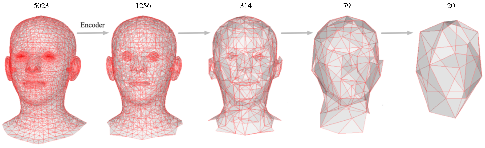

# Efficient Pooling Operator for 3D Morphable Models

Official implementation of **Efficient Pooling Operator for 3D Morphable Models**, published in *IEEE Transactions on Visualization and Computer Graphics (TVCG)*.

This repository provides an improved pooling and unpooling framework for convolutional mesh autoencoders. The implementation builds upon [Generating 3D Faces Using Convolutional Mesh Autoencoders (CoMA)](https://arxiv.org/abs/1807.10267) and retains its general training and evaluation pipeline.

Our method incorporates vertex normal information and adjacent face areas into quadric-based mesh simplification. We also improve the unpooling operation at low mesh resolutions to reduce template overfitting and improve reconstruction accuracy without substantially increasing computational cost.

## Overview

Mesh autoencoders use hierarchical pooling and unpooling operations to learn compact representations of 3D shapes. Existing approaches typically construct their sampling matrices from a single template mesh, which may not adequately preserve geometric details across different shapes.

Our method introduces two improvements:

- **Geometry-aware pooling:** Incorporates vertex normals and adjacent face areas into the quadric error metric to preserve geometric features during mesh simplification.
- **Improved unpooling:** Uses a learned coarse-to-fine mapping at lower resolutions to improve vertex reconstruction and reduce dependence on the template mesh.

The proposed operators can be integrated into existing mesh autoencoder architectures without changing their convolutional layers.

## Pooling Operation

The original CoMA framework constructs a multiscale mesh hierarchy through quadric mesh simplification. Its pooling operation contracts edges according to a quadric error metric, while the unpooling operation restores discarded vertices using barycentric coordinates.

Our method extends the quadric error metric by incorporating the areas of adjacent faces and vertex normal information.

For each vertex, the modified quadric error is defined as:

\[
Q_v(v) = \sum_{f \ni v} \operatorname{area}(f) Q_f^g(v) + \lambda_{vn} Q_f^{vn}(v)
\]

where the first term measures the area-weighted geometric error and the second term penalizes deviations in vertex normals.

In our experiments, we use \(\lambda_{vn} = 0.005\).

This modification produces a more geometry-aware mesh hierarchy, particularly at lower resolutions where conventional quadric simplification may lose important shape features.

## Unpooling Operation

In conventional mesh autoencoders, the unpooling matrix is constructed by projecting discarded vertices onto the closest triangles of a downsampled template mesh.

However, this projection may introduce errors on highly curved surfaces and may not generalize well to other meshes sharing the same topology.

Our approach improves the unpooling operation by learning a coarse-to-fine mapping from a subset of training meshes.

We randomly select 0.5% of the training meshes to construct the improved unpooling mapping. To maintain computational efficiency, we modify only the lower-resolution unpooling layers while retaining the original sparse matrices at higher resolutions.

The resulting operators provide more accurate vertex initialization during mesh reconstruction.

## Installation

The implementation follows the original CoMA training framework.

The original code was developed using Python 3.6 on Ubuntu 16.04 and tested with an NVIDIA 2080 Ti GPU.

Main dependencies include:

- [PyTorch](https://pytorch.org/) (1.3.0)
- [PyTorch Geometric](https://github.com/pyg-team/pytorch_geometric) (1.3.0)
- [OpenMesh](https://github.com/nmaxwell/OpenMesh-Python) (1.1.3)
- [MPI-IS Mesh](https://github.com/MPI-IS/mesh)
- [tqdm](https://github.com/tqdm/tqdm)

These versions correspond to the original implementation. Depending on the environment, additional configuration may be required.

## Interpolation Experiment

We evaluate the proposed pooling and unpooling operators on registered 3D mesh datasets, including CoMA and DFAUST.

For the CoMA dataset, we follow the original training and testing split with a ratio of 9:1.

To train and evaluate the model, run:

```bash
bash train_interpolation.sh
```

The training checkpoints are saved in the corresponding experiment directory specified by `exp_name`.

After training, the reconstruction errors, including the mean Euclidean error, standard deviation, and median error, are saved in `euc_error.txt`.

## Extrapolation Experiment

The extrapolation experiment evaluates reconstruction performance on expressions excluded from training.

Specify the test expression using the `test_exp` variable and run:

```bash
bash train_extrapolation.sh
```

## Data

The implementation uses `torch_geometric.data.Data` to represent meshes.

Each mesh should provide at least:

- `data.x`: Node feature matrix with shape `[num_nodes, num_node_features]` and type `torch.float`.
- `data.edge_index`: Graph connectivity in COO format with shape `[2, num_edges]` and type `torch.long`.

The mesh connectivity should remain consistent across registered samples.

Please refer to the `datasets.FAUST` and `datasets.CoMA` classes for examples of dataset preparation.

## Acknowledgments

This implementation builds upon the CoMA framework introduced by Ranjan et al.:

[Generating 3D Faces Using Convolutional Mesh Autoencoders (ECCV 2018)](https://arxiv.org/abs/1807.10267)

We thank the original authors for making their work publicly available.

## Citation

If you find this work useful, please cite our paper:

```bibtex
@article{zhang2023efficient,
  title     = {Efficient pooling operator for 3D morphable models},
  author    = {Zhang, Haoliang and Cheng, Samuel and El Amm, Christian and Kim, Jonghoon},
  journal   = {IEEE Transactions on Visualization and Computer Graphics},
  volume    = {30},
  number    = {7},
  pages     = {4225--4233},
  year      = {2023},
  publisher = {IEEE},
  doi       = {10.1109/TVCG.2023.3255820}
}
```
